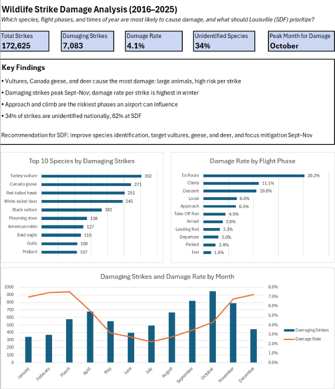
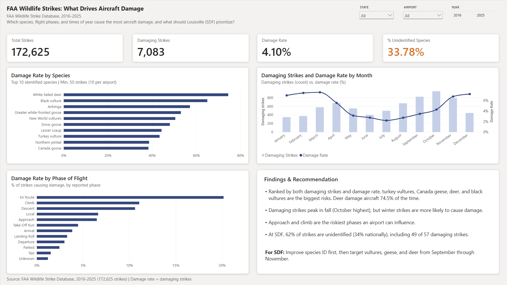

# Wildlife Strike Damage Analysis (2016–2025)

## Question
Which wildlife species, flight phases, and times of year are most likely to
cause aircraft damage when struck, and what should an airport like
Louisville (SDF) prioritize to reduce it?

## Key Findings
- **Large animals cause the most damage.** Turkey vultures, Canada geese,
  white-tailed deer, and black vultures rank highest for both total damaging
  strikes and damage per strike. Deer strikes damage the aircraft 74.5% of
  the time.
- **Fall is the highest-risk season.** Damaging strikes peak September
  through November, with October the highest (947). Winter has fewer
  strikes, but a higher share of them cause damage.
- **Approach and climb are the riskiest phases an airport can influence.**
  Strikes at cruising altitude are the most damaging, but they happen far
  from airports. Approach has the most damaging strikes overall (2,649).
- **Many strikes are never identified.** 34% of strikes nationally are
  recorded as "unknown bird," compared with 62% at SDF. At SDF, unknown
  birds caused 49 of 57 damaging strikes.

## Recommendation for SDF
1. Improve species identification (for example, through the Smithsonian
   Feather Identification Lab), since most of SDF's damaging strikes can't
   be traced to a species
2. Until local data improves, focus on the species that cause the most
   damage nationally: vultures, geese, and deer
3. Concentrate mitigation efforts in September through November

## Data
- Source: [FAA National Wildlife Strike Database](https://wildlife.faa.gov),
  downloaded November 2026
- 360,607 total strikes; this analysis uses the 172,625 from 2016–2025
- Raw data is not included in the repo due to file size

## Tools
Excel: Power Query, PivotTables, PivotCharts, XLOOKUP, COUNTIFS, and
conditional formatting
Power BI (DAX, Power Query)

## Power BI Version

Rebuilt the dashboard in Power BI to add filtering by state, airport, and year.

- DAX measures for total strikes, damaging strikes, damage rate, and % unidentified species
- A minimum-volume damage rate measure (50 strikes nationally, 10 per airport), built into
  the measure because Power BI's Top N filter runs before visual-level filters
- A combo chart comparing damaging strike counts with damage rate by month
- Totals reconciled with the Excel version (172,625 strikes, 33.78% unidentified)

## Approach
1. Reviewed every column for missing values before cleaning
2. Cleaned the data in Power Query: filtered to 2016–2025, set data types,
   labeled blanks, and added columns for damage severity, airport location,
   and month
3. Checked the damage fields for contradictions
4. Analyzed damage by species, month, flight phase, and airport
5. Looked at Louisville (SDF) specifically to turn the findings into a
   local recommendation
6. Built a dashboard to summarize the results

## Key Decisions
- **Switched from cost to damage.** The original question focused on cost,
  but 98% of strikes have no cost recorded. Damage rate (the percentage of
  strikes that cause damage) became the main measure.
- **Used damage rate instead of strike counts alone.** Most strikes cause
  no damage, and reporting is voluntary, so counts by themselves can be
  misleading.
- **Set a minimum number of strikes for species rankings.** 50 nationally
  (the same cutoff used in FAA/USDA research) and 10 at SDF, so species
  with only a handful of strikes don't skew the results.
- **Excluded unknown birds from species rankings,** since they can't be
  targeted, but reported them as a limitation.
- **Classified strikes at or below 500 feet as on or near the airport,**
  following FAA/USDA research. When height was missing, flight phase (such
  as taxi or landing roll) was used instead.
- **Kept rows with missing values and labeled them "Unknown"** rather than
  deleting them, so no damage data was lost.
- **Excluded 2026** because the year is incomplete.

## Data Quality Checks
- No strikes were marked as undamaged while also having a damage level of
  Minor, Substantial, or Destroyed, or the reverse

## Limitations
- Reporting is voluntary, so the data reflects reported strikes, not all
  strikes
- 58% of strikes are missing both height and flight phase, so location
  comparisons use only the 42% with known location
- Cost data is too incomplete to estimate financial impact
- SDF has too few damaging strikes to rank species reliably on its own

## Files
- `excel/wildlife_strikes.xlsx`: Power Query cleaning steps, PivotTables,
  and dashboard
- `powerbi/wildlife-strikes.pbix`: Power BI report
- `notes.md`: working notes, data dictionary, and decision log
- `images/dashboard.png`: dashboard screenshot

## How to Reproduce
1. Download the database from wildlife.faa.gov (Excel format)
2. Save it to `data/raw/`
3. Open `excel/wildlife_strikes.xlsx` and select Data → Refresh All
